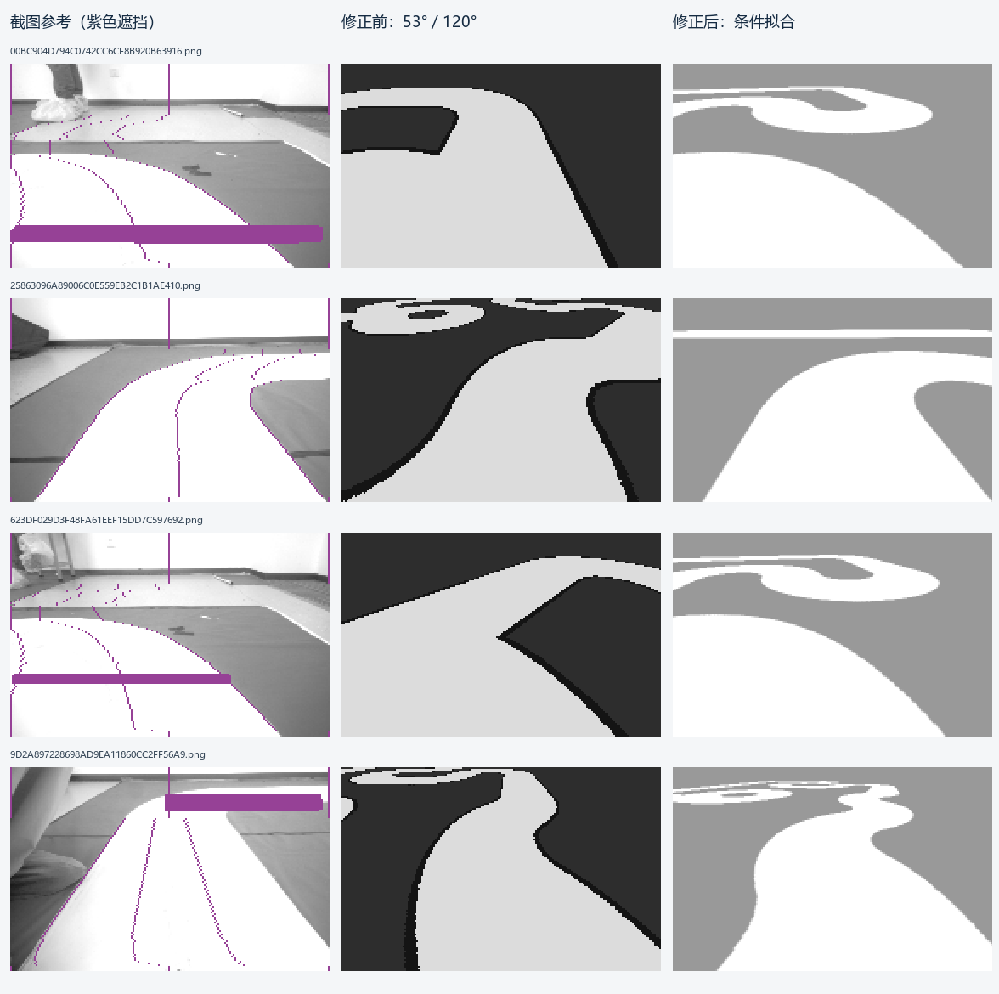
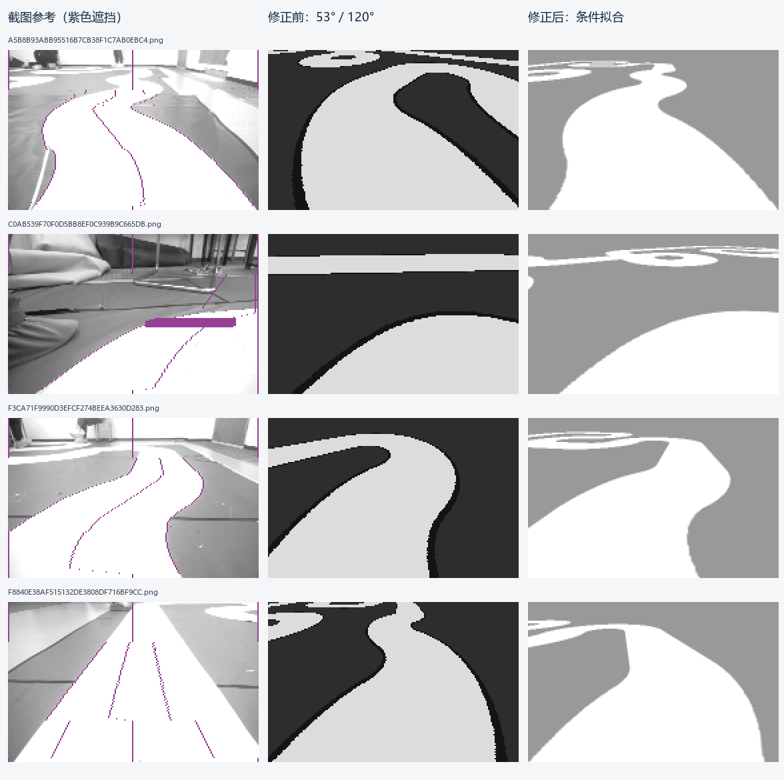
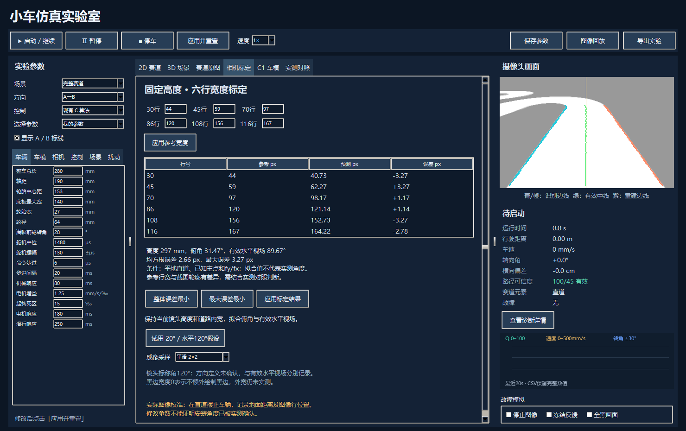

# 仿真相机修正与验证

日期：2026-10-12（Asia/Shanghai）。范围：`simulation/` 的相机、标定、截图对照、配置与相关测试。用户已明确批准执行。未修改 `car/`、供应商算法副本或实测截图，未操作硬件。

## 结果

固定镜头中心高度297mm、道路内宽500mm、镜头后轴前80mm。当前默认和“我的参数”采用 **31.46896°俯角、89.66951°有效水平视场**，两者均为条件拟合值，不是实测角度。“120°畸变角”的原始记录仍保留，未把它换算为畸变系数。

| 检查 | 修正前 | 修正后 |
| --- | --- | --- |
| 六行参考宽度最大绝对误差 | 36.79px | 3.27px |
| 六行参考宽度均方根误差 | 见下表 | 2.66px |
| 8张截图配准后平均道路区域IoU | 85.95% | 90.71% |
| 仿真测试 | 13项中2项旧断言失败 | 22项全部通过 |
| 真实Tk界面 | 本轮修正前未验收新功能 | 6种采样组合往返、保高标定、保存加载、8图导入、起步停车通过 |

**两个指标的证据范围不同：**六行误差是对拟合输入的残差；截图IoU是独立估计每图车姿后的配准诊断。相机参数在截图配准时固定，但实际拍摄车姿未知，因此不能把90.71%解释为已知位置下的相机标定精度或整个实测环境的还原率。

## 修正内容与依据

1. **固定高度标定。**旧程序固定120°水平视场，改变高度来适配行宽；现在固定高度和道路内宽，拟合未知俯角、有效焦距。不相容输入明确拒绝，不改高度补偿。
2. **统一成像。**射线采样、地面投影、3D视锥及直道误差使用共同相机定义。直道表格原先忽略非零畸变，已修正；负畸变折叠分支增加单调性和射线回代检查。
3. **像素覆盖和场景灰度。**默认2×2采样及双线性插值，降低最近邻锯齿。允许黑边0mm，采用白色255/背景153的截图亮度近似；外宽仍未知，这些是渲染选择。旧配置的单点最近邻行为继续可选。
4. **确定性对照。**默认及“我的参数”关闭随机扰动；原3级扰动连同53°/120°配置保存在历史预设和完整备份中。控制参数未改。
5. **截图输入。**“实测对照”可导入完整逐飞助手截图，识别188×120区域的缩放关系并显示遮挡掩码；彩色识别线、文字处用紫色标记，不补造原始像素。任意尺寸图片不会被强制拉伸用于回放。
6. **说明和配置。**分开保存镜头标称角、有效模型角和实测尺寸；更新默认、我的参数、完整赛道参考、中期区段四个配置。

独立审查发现的“采样组合加载后被改写”和“极端姿态的负畸变虚假边界”均先复现再修复；新增测试和实际控件往返验证通过。

## 六行参考对照

| 行号 | 输入参考px | 修正前预测px | 修正后预测px |
| --- | ---: | ---: | ---: |
| 30 | 44 | 43.08 | 40.73 |
| 45 | 59 | 58.28 | 62.27 |
| 70 | 97 | 83.61 | 98.17 |
| 86 | 120 | 99.82 | 121.14 |
| 108 | 156 | 122.11 | 152.73 |
| 116 | 167 | 130.21 | 164.22 |

采用最大绝对残差最小目标，所以不是每一行都更接近参考；它显著减小近场偏窄，但没有把六点逐点强行拟合成零误差。

## 截图对照

对每组相机模型，在相同完整赛道和相同搜索预算下估计每张图的车辆位置与方向。固定R500mm中心半径及道路内宽，不为单张图改赛道。使用第30至115行、排除彩色覆盖与文字，白色区域阈值235；生成完整188×120图像后计算有效区域IoU。

| 截图文件前缀 | 修正前IoU | 修正后IoU |
| --- | ---: | ---: |
| 00BC904D | 76.52% | 88.04% |
| 25863096 | 86.52% | 95.44% |
| 623DF029 | 85.25% | 89.56% |
| 9D2A8972 | 85.92% | 89.71% |
| A5B8B93A | 86.86% | 86.28% |
| C0AB539F | 94.58% | 97.81% |
| F3CA71F9 | 87.65% | 90.58% |
| F8840E38 | 84.29% | 88.26% |

7张改善，A5B8…下降约0.58个百分点。配准可能匹配到另一段相似道路；图中三列不是已知相同车姿的物理复现。画面顶部、人物、墙体等不在上述IoU验收范围。

完整参数、每帧估计车姿及精确指标：[alignment-results.json](camera-alignment-2026-10-12/alignment-results.json)。

## 已执行验证

- 修改前的原13项测试：11通过，`test_fit_constraints_and_nominal_conflict`、`test_bad_parameters_rejected`因旧默认值/开关规则断言失败。临时验证副本曾缺少桥接C文件，补齐后确认上述正式基线；未把副本准备错误算作原工程故障。
- 修改后的完整仿真测试：22通过、0失败、0错误。涵盖独立几何夹具、畸变往返、保高拟合、错误数据拒绝、像素覆盖、截图遮挡及原有控制保护。[测试日志](../../logs/simulation-camera-tests-2026-10-12.log)。
- 真实Tk窗口：6种合法采样组合加载/收集保持一致，参数保存加载一致，标定先预览再应用保持297mm，8张截图可导入；4秒闭环运行，停车后驱动归零，界面无错误。[GUI结果](camera-alignment-2026-10-12/ui-checks.json)。
- 正反方向各10秒闭环：均保持运行、无故障，距离分别约1.154m、1.531m。这不是完整赛道完赛测试。
- 相机150帧短测：旧模型中位0.58ms、P95 0.73ms；2×2平滑模型中位4.55ms、P95 5.26ms。平滑更耗计算，短测仍低于50FPS的20ms帧间隔；不是高倍速实时性能保证。[运行检查](camera-alignment-2026-10-12/runtime-checks.json)。
- 启动脚本在临时镜像中 `-CheckOnly` 成功，解释器为64位Python3.14.6，Tkinter/NumPy2.4.6/Pillow12.3.0可用。未安装软件。
- 验证副本与交付Python源码逐字节一致；主工程应用/配置及8张原截图共46个保护文件哈希不变，`simulation/vendor/`不变，备份ZIP完整性检查通过。

## 仍未解决的实测约束

- 近直道F884…截图第30行白色真实道路约59px，而六行参考为44px。单图条件解约27.38°/70.51°在部分其他弯道更差，因此未作为共同相机参数。数据冲突仍保留，直道轮廓误差没有完全消除。
- 120°的定义、真实主点、俯角、偏航/横滚、畸变没有实测标定；当前角度仅在既定假设下有效，不能写回硬件事实为已测。
- 外宽、黑边结构、真实赛道坐标与拍摄车姿未知。实际背景、接缝、阴影、曝光响应和杂物没有建模，截图覆盖处不能恢复原始灰度。
- 电机/舵机动态和最大前轮角仍是假设；本轮未改C算法、未刷写或运行实车。

## 文件与复现

- 启动：[启动仿真.cmd](../../simulation/启动仿真.cmd)。关闭旧窗口重新打开，选择“我的参数”。
- 当前配置：[我的参数.json](../../simulation/configs/我的参数.json)。
- 修正前配置：[历史_297mm_53度.json](../../simulation/configs/历史_297mm_53度.json)。
- 模型与使用说明：[camera-alignment.md](../../simulation/docs/camera-alignment.md)。
- 完整备份：[simulation_before-camera-realignment_20261012_165857.zip](../backups/simulation_before-camera-realignment_20261012_165857.zip)。
- 在项目根目录执行 `D:\anaconda3\python.exe -B simulation/tools/check_camera_alignment.py --images tmp/figs --output tmp/camera-check/alignment` 可重做轮廓对照；其他机器替换解释器路径。
- `tools/check_camera_ui.py --images tmp/figs --output tmp/camera-check/ui` 可重做界面检查；测试会短暂打开并关闭窗口。

本轮仅清理 `tmp/camera-realignment/`。用户的 `tmp/figs/` 及其他任务临时目录保留。
