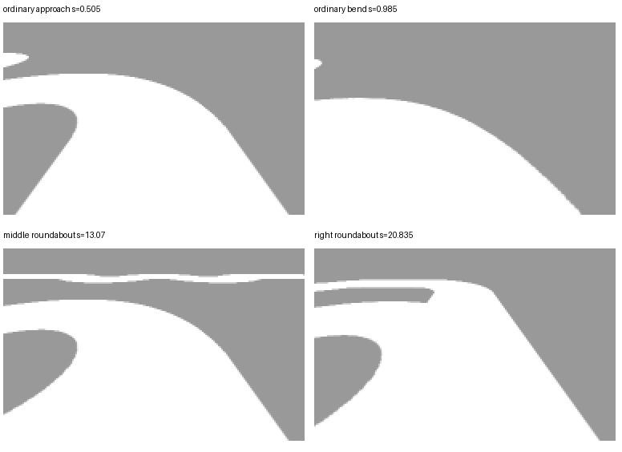

# 元素识别与提速：参数试验及逻辑修正提案

> 本文保留18:00初始诊断历史。用户随后已批准逻辑修正，修改、双向整圈及提速验证已执行。当前参数、固件与未完成边界以[最终验收报告](control-tuning-final-2026-10-12.md)为准；下文“待批准/未修改”只描述当时状态。

日期：2026-10-12，Asia/Shanghai。用户批准先定位、调参、仿真验证；发现仅参数难以解决的逻辑缺陷时，提交证据和具体修改范围再审核。本阶段没有写回主工程参数或算法，也没有生成发布固件、刷写或实车运行。

## 结论

已完成正反向基线、49轮参数试验（包含部分重复对照，共245个回放片段）、4次附加闭环和5档直道速度试验。**本轮搜索范围内没有找到同时消除普通弯道误判、又正确进入并退出两个真实环岛的合格组合。**这不是全参数空间不可解的数学证明，但已有源码和复现证据表明，需要修正元素判据及候选状态恢复，再继续优化速度和PID。

主工程与仿真的 `track_vision.c`、`autonomous_drive.c`、`control_pid.c`、对应头文件及配置逐字节一致。试验使用上一阶段的共同相机模型：高297mm、后轴前80mm、道路内宽500mm、条件俯角31.46896°/有效水平视场89.66951°、2×2平滑、无随机扰动。未为改善控制结果改变这些条件。

## 闭环复现

| 配置 | 方向 | 首次环岛候选 | 触发停车 | 停车原因 | 结果 |
| --- | --- | --- | --- | --- | --- |
| 原配置180/120/80mm/s | A→B | 5.27s，路径进度约0.511m | 38.59s | 路径丢失 | 首段普通弯道被当成环岛，未完赛 |
| 原配置180/120/80mm/s | B→A | 31.65s，路径进度约4.345m | 52.77s | 路径丢失 | 普通弯道被当成环岛，未完赛 |
| 环岛确认40帧，其余原值 | A→B | 7.83s | 10.35s | 路径丢失 | 推迟候选，但更早失去路径 |
| 环岛确认40帧，其余原值 | B→A | 34.33s | 36.51s | 路径丢失 | 同类结果 |
| 确认40帧，300/220/160mm/s，PWM300‰ | A→B | 5.65s | 7.35s | 路径丢失 | 提速没有消除识别问题 |
| 上述高速配置，Kp36/Kd0.8 | A→B | 5.65s | 34.17s | 路径丢失 | 仍错误进入环岛状态，未完赛 |

导出的结果时间包含停车后的2秒采集，因此JSON中的time_s比表中停车触发时刻多2秒。上述未发生两轮出界不代表完赛通过；它们由路径保护提前停止。

正向原配置错误状态链：5.27s候选 → 10.17s入环 → 11.83s环内 → 31.09s出环 → 38.59s路径丢失；该段真实几何是普通连续弯道。

[闭环结果](control-tuning-2026-10-12/closed-loop-results.json)；[正向事件](control-tuning-2026-10-12/AB-events.json)；[反向事件](control-tuning-2026-10-12/BA-events.json)。

## 参数搜索方法与结果

先按现有赛道中心线以5mm间距生成6005帧固定图像，再以250mm/s对应的20ms间隔输入真实C视觉算法。该回放只评估识别，不驱动车辆，也不算闭环完赛。每个片段重置算法，避免前一处错误状态污染下一处测试。

负例：首段普通弯道、连续U弯、S弯。正例：中央环岛和右侧环岛。场景标签仅供试验评分，未输入视觉算法。

- 初始13轮：确认帧数3/6/12，开口行数12/18/24/32，边线窗口26/34/42，对侧连续比例80/90/95，组合门限，入环行94/80，以及透视宽度41/164对照。
- 后续36轮：开口行数12/24/40/56 × 确认帧数3/12/40 × 入环行70/80/94。
- 原配置在普通弯道、两个真实环岛上都进入候选，但回放没有完成真实环岛入环。
- 将入环行提前到80后，两个真实环岛能进入环内，但普通弯道也错误进入环内，真实环岛出口仍未完成。
- 40帧确认等严格组合消除了部分或全部普通弯道候选，同时漏掉中央环岛或两个环岛。
- 在本批片段中，没有组合满足“负例不进入环岛候选，两个正例都进入并退出环岛”的验收条件。

完整逐轮汇总：[parameter-trials.csv](control-tuning-2026-10-12/parameter-trials.csv)。不能把静态/回放片段通过替代后续闭环、多种起步偏差及随机种子验证；本轮候选未通过基础筛选，因此没有发布所谓“最优参数”。

## 源码已确认的问题

1. **候选证据不够区分普通弯道。** `track_vision.c` 的340–341行以单侧有界开口、另一侧无开口和对侧连续形成候选。原生图像中普通弯道和真实环岛都能满足该条件；多帧确认只能确认这个相似特征持续存在，不能自动补充环岛身份信息。
2. **候选退出依赖恢复直道。** 339行的 `normal` 要求双边覆盖足够、路径有效且不弯曲；361行又要求 `normal && !same_gap` 才撤销候选。在弯道上失去候选证据后，仍可能长期保留候选。
3. **未确认候选阻断普通弯道外侧重建。** 272行要求内部阶段不超过普通弯道，且不能存在有界开口。错误候选会排除可靠外侧重建机会。闭环将确认帧数从3提高到40后，正向反而更早因路径丢失停止，说明延迟状态升级并未恢复正常路径处理。
4. **入环门限存在明显误判/漏判交换。** 360行同时要求同侧有界缺口、有效路径、缺口下沿达到第94行；这批真实入口未稳定满足，提前到80则把普通弯道一起放行。需要增加判别证据与阶段一致性，不宜继续只降低该行号。

源位置：[track_vision.c](../../car/src/track_vision.c)。上述为已复現源码行为；新判据的效果仍需实施后验证。

图中上方为普通弯道、下方为两个真实环岛接近过程。均为固定车姿的仿真灰度输入，不是实车照片。近场轮廓相似，仅凭单侧缺口不能保证分类正确。

## 提速约束

当前 `AUTO_MAX_DUTY_PERMILLE=200`；工程硬限幅和编译检查允许最高300‰。电机模型采用 `(PWM−15)×1.25 mm/s`，因此本模型在200/300‰时的稳态上限为231.25/356.25mm/s。这是未实测标定的模型结论，不是实际电机最高速度。

保持模型不变，各直道试验运行15秒，取最后约3秒平均值：

| 目标速度mm/s | PWM限幅‰ | 稳态速度mm/s | 平均PWM‰ |
| --- | ---: | ---: | ---: |
| 180 | 200 | 178.28 | 157.73 |
| 250 | 250 | 248.73 | 214.03 |
| 300 | 300 | 298.79 | 254.07 |
| 350 | 300 | 348.82 | 294.07 |
| 400 | 300 | 356.25 | 300.00 |

这些只证明直道速度闭环在该模型下能达到约300–350mm/s，不能证明高速度过弯或环岛成功。未经执行器实测标定，不据此宣称实车高速性能。

[速度试验数据](control-tuning-2026-10-12/speed-probe.json)。

## 待批准的具体修正范围

保持现有扫线、状态机和PID框架，建议扩展到以下逻辑修正：

1. **原始元素证据与路径重建分开。** 在原始灰度/边线证据上检查分叉、边线走势及其连续变化；路径重建不反过来伪造元素证据。未确认候选仍允许有充分实测外边支持的普通弯道循迹。
2. **可撤销的候选状态。** 增加证据消失、相互矛盾和候选距离边界的恢复规则，车辆仍在弯道时也能撤销错误候选，不要求必须先恢复直道。
3. **入环、环内、出环联动验证。** 在同侧开口之外补充入口分叉/边线形态及时间顺序证据；修改入口推进和出口恢复判据，使降低漏判不会仅靠降低门限扩大误判。
4. **识别通过后再优化速度。** 分别搜索直道、普通弯道和元素区速度、近远预瞄权重、转向PID及输出斜坡；先验证250/300mm/s档，再检验当前模型能支持的更高档。保留失帧、失反馈、堵转、超速和路径失效保护。

拟修改文件：`car/src/track_vision.c`、必要的 `car/include/track_vision.h`、`car/config/vision_config.h`；视控制瓶颈调整 `car/src/autonomous_drive.c`、`car/config/autonomous_config.h`。同步仿真算法副本、参数映射和诊断导出，补充对应测试、文档及日志。屏幕/Wi-Fi冻结模块与硬件接线不在范围内。

验证顺序：失败帧及状态序列回归 → 独立弯道/十字/左右环岛场景 → 正反向闭环 → 不同速度、起步偏差和多个种子 → 全套相关测试及Keil构建。只有通过验收的候选写入主工程发布配置；分别记录模型下最佳组合、失败边界与未验证项，不宣称全局最优。

此处是待审核设计，没有提前应用算法逻辑修改。

## 追溯与收尾

- 修改前工程备份 autocar_before-control-tuning_20261012_174205.zip（已于 2026-10-15 精简中删除）：705个源文件/文档/固件，核对无变化。
- [可复现实验包](../backups/control-tuning-diagnostics_20261012_175808.zip)：包含脚本、独立源码、参数矩阵、6005帧缓存和诊断结果，ZIP完整性检查通过。仪器化代码仅增加输出观察值，未写回主工程。
- [诊断汇总](control-tuning-2026-10-12/diagnostic-summary.json)。
- 未修改主工程，因此本阶段不重建或替换固件；尚未完成后续算法优化目标。
- 本阶段结束仅清理`tmp/control-tuning/`；继续时可从实验包恢复，避免重复生成基线。
