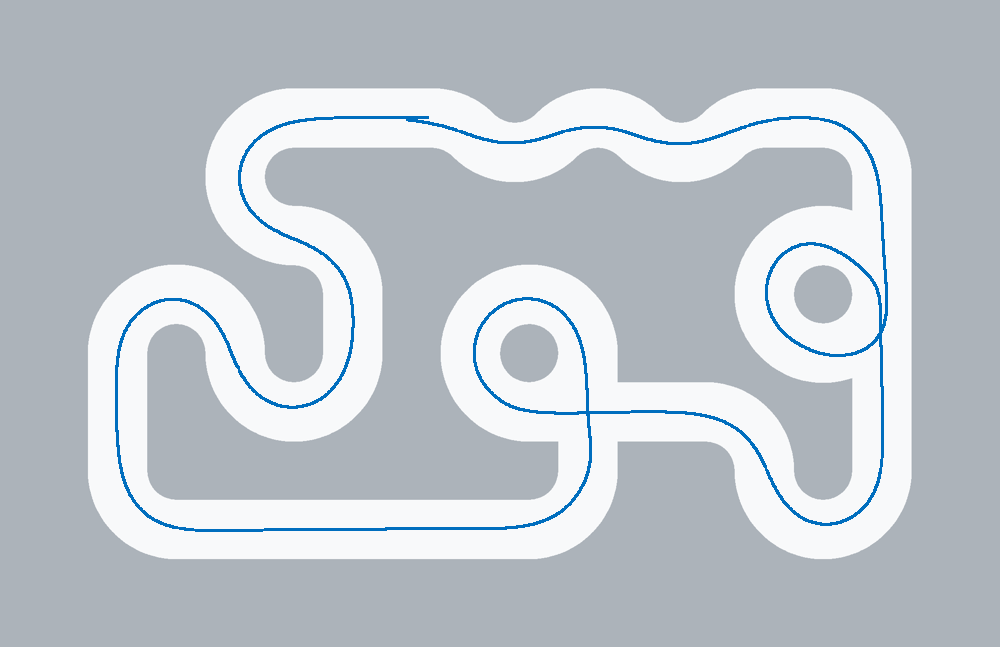
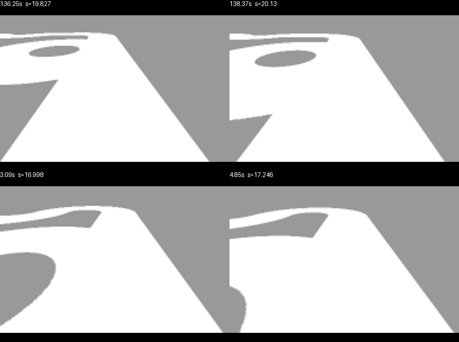

# 元素识别修正与分档提速验收

日期：2026-10-12。用户已批准必要的视觉状态机逻辑修正，要求中低速稳定优先，允许提高PWM上限，实车后续目标3.6m/s。

## 结果与默认参数

现有扫线、状态机和PID框架已修正，主工程`car/`与仿真`simulation/vendor/`已同步。当前条件模型下，低速、中速、提速三个档位均完成约30.021m参考路线的双向闭环，零轮出界、无控制故障。默认采用中速档。**这是仿真验收，不是实车完赛、3.6m/s验收或全参数空间的最优证明。**

| 档位 | 直道/弯道/可靠外侧/元素，mm/s | PWM上限‰ | 正向s | 反向s | 最大路径偏差，正/反cm |
|---|---|---:|---:|---:|---:|
| 低速 | 180 / 120 / 80 / 100 | 200 | 294.50 | 297.61 | 12.35 / 11.02 |
| 中速，当前默认 | 300 / 200 / 140 / 160 | 300 | 175.09 | 176.59 | 12.57 / 11.01 |
| 本轮最高已验档 | 350 / 240 / 180 / 180 | 300 | 144.54 | 144.42 | 12.70 / 11.06 |

初始算法在相同相机和车辆模型下，正向38.59s、反向52.77s因路径丢失停车，均把普通弯道误升为环岛。原始49轮参数搜索、245个回放片段没有合格组合；随后才按授权修改逻辑。本次没有通过移动赛道、改变相机高度/俯角/视场或虚增电机增益获得通过结果。

参考路线长30.021m，实际行驶约28.8–28.95m；车在500mm宽道路内存在横向偏差。完赛评分要求依次推进到路线末端，不能凭总里程或绕过环岛算通过。A/B终点是仿真位置标记，此项未模拟实际斑马线终点停车。



[反向轨迹](control-tuning-2026-10-12/final-BA.png)；[初始参数搜索](control-tuning-2026-10-12/parameter-trials.csv)；[初始诊断历史](control-tuning-2026-10-12.md)。

## 主要修正

1. **原始识别证据与补线分离。** 元素判断读取第一遍扫线结果，外侧重建不再改写原始开口、分叉和误差。未确认候选仍可使用当前可靠外边正常过弯。
2. **候选可撤销。** 限700mm/10s，先检查失效边界再决定入环。缺口/分叉消失或出现矛盾证据时连续3帧撤销，不要求先回到直道。失帧、空输入打断连续确认计数。
3. **入口验证方向与岛边。** 在有界缺口、对侧连续、当前白区连接和前向走廊之外，新增近端实测岛边凸性，拒绝反向汇入支路。要求至少12行连续边、连续3行向路内偏离弦线至少2px；初始候选与提交入口均检查。实际负例内凸仅0.10/0.76px，真实入口为19.91/8.03px。
4. **十字跟踪前向出口。** 单条横向支路边不能重定义来向；优先近场双边，再关联实际远方出口。双侧开口通过近场并重新闭合后即可恢复，紧接的弯道不再卡住十字状态。
5. **出口预告与执行分开。** 已确认环内才接受新的外侧有界缺口，或有近场外边支持的连续外扩。3帧确认预告，开口到108行近场后再出环。出口预告及相对图像路径共用700mm/8s总寿命，不被中间高Q帧刷新。100mm/s通过700mm需7s，因此时间上限留1s响应余量。
6. **有限缺边过渡。** 已确认元素才可使用短距离记忆；逐行验证当前白像素，当前双边闭合走廊优先。弱证据白区另限600mm/6s。横向轮廓只是当前白区存在的条件，不等同左右实测边，更不代表统计置信概率。全黑、全白、黑色前路、超距和超时仍会失效。
7. **近场偏差优先。** 近远误差异号且近场偏差达到12–32px时，渐进提高近场权重，避免远处分支的反向误差抵消当前转向。小偏差仍用0.45/0.55权重，Kp28、Ki0、Kd0.5保留。
8. **参数贯通。** 软件舵机步进6→12µs/20ms；运行上限180→480s，以覆盖低速30m路线。默认PWM200→300‰，仍在原后端300‰硬限幅内。仿真新增元素速度/PWM上限，确实映射到C宏；历史配置缺字段时保留100mm/s、200‰。



## 尚未解决的识别边界

中央270°环形路段已能双向循迹通过，但入口目前仍输出CURVE。源码复核与独立审查确认：沿近场来向外推后进入灰背景，当前图像没有判据要求的直行分支，局部画面可与普通U弯相似。**未用地图位置强制标为环岛，也没有宣称所有环岛身份已正确识别。**右侧360°环岛已完成双向“候选→入口→环内→出口”状态链；普通弯道及反向汇入口负例不再误入环岛。

中央环道若必须提前明确输出环岛身份，需要额外可观察证据，例如实车连续视频中的完整岛边拓扑，或经标定的累计转角。现有输入仅灰度、时间、前进里程，降低阈值不能保证区分局部相似画面。[中央入口对照](control-tuning-2026-10-12/central-observability.png)。

## 扰动与姿态验收

| 条件 | 档位 | 正/反耗时s | 最大偏差cm，正/反 | 结果 |
|---|---|---|---|---|
| 基准，无扰动 | 中速 | 175.09 / 176.59 | 12.57 / 11.01 | 双向完成、零轮出界 |
| 2级扰动，种子7 | 中速 | 175.13 / 176.55 | 12.56 / 11.05 | 双向完成、零轮出界 |
| 初始左偏30mm、左偏航5° | 提速 | 144.60 / 144.42 | 12.70 / 11.06 | 双向完成、零轮出界 |
| 3级扰动，种子42 | 提速 | 143.72 / 144.40 | 12.68 / 11.05 | 双向完成、零轮出界 |

2级扰动幅值：起步横偏±10mm、偏航±2°、亮度±8、灰度噪声σ2；3级分别为±20mm、±4°、±15、σ4。样本有限，不代表所有光照、轮胎或赛道变化。验收工具记录参数、源码SHA256、C构建指纹、状态事件、全程遥测和轨迹；地图用于渲染和评分，不作为C控制输入。

## 软件和固件验证

- 原生工程行为测试：**95项通过，0失败、0错误**，含24项新增灰度/元素序列回归，以及控制、伺服、电机、编码器、遥控、图传等原有检查。
- 历史15项PWM预期不符已修正测试夹具：按现有配置检查硬限幅和命令值，超限输入仍检查饱和，遥控功能代码未改。另两项新速度档暴露的起步斜坡/固定80mm/s预期也已修正。
- 仿真测试：**25项通过**。真实Tk控件检查通过：配置选择、元素速度/PWM修改、保存回读、C算法启动、图像丢失停车。
- Keil5.39 / Armclang6.21全量构建：**0错误、0警告**；Code115120、RO13200、RW300、ZI104872字节。任务副本的src/include/config/library逐文件与主工程一致；固件已交付`outputs/firmware/`。
- 构建脚本的4项模拟工具测试未计入上述95项。本机Windows拒绝启动临时假UV4.exe，早期两项成功路径报“操作已被用户取消”；未绕过该限制。已安装的真实Keil构建及三格式导出成功。
- `main.c`、屏幕和Wi-Fi模块哈希保持不变。未刷写、通电或实车运行。

[工程测试日志](../../logs/control-tuning-tests-2026-10-12.log) · [仿真测试日志](../../logs/control-tuning-simulator-2026-10-12.log) · [构建日志](../../logs/control-tuning-build-2026-10-12.log)

## 使用与复现

双击[启动仿真.cmd](../../simulation/启动仿真.cmd)，选择“我的参数”或“中速验证_300”，应用并重置，再启动。也可选择“低速验证_180”或“提速验证_350”。默认关闭扰动；比较改动时固定随机种子。

```powershell
# 在Autodrive根目录执行，解释器路径按本机环境替换。
& 'D:\anaconda3\python.exe' -B simulation/tools/validate_control.py `
  --config simulation/configs/中速验证_300.json `
  --output tmp/control-check/default --directions AB BA
```

加`--disturbance 2 --seed 7`，或`--offset 0.03 --heading 5`可复现扰动/姿态条件。工具在输出目录下复制C源码并编译，结果汇总在`summary.json`；`pass_run`要求完成路线、零轮出界、无故障。

主要入口：[视觉](../../car/src/track_vision.c)、[视觉参数](../../car/config/vision_config.h)、[控制参数](../../car/config/autonomous_config.h)、[验收工具](../../simulation/tools/validate_control.py)。

## 实测事实与3.6m/s目标

固定使用已确认的镜头中心高度297mm、前轴后110mm、赛道内宽500mm。俯角31.46896°及有效水平视场89.66951°仍为条件拟合；“120°畸变角”的方向定义、真实畸变及外宽尚未测定。见[相机校准报告](camera-alignment-2026-10-12.md)。

电机模型增益1.25mm/s/‰、死区15‰、机械响应和最大前轮转角28°仍是假设。该模型中PWM300‰的稳态上限约356.25mm/s，400mm/s目标会饱和；这不是实车最高速度。固件仍保留900mm/s异常速度保护。**实车3.6m/s需要实测PWM—轮速、电池电压、舵角—脉宽、响应延迟与轮胎抓地数据，再调整速度前馈、保护边界和高速控制。**本轮没有更改未知物理参数伪造高速通过。

当前模型中的普通弯误升环岛、真实右侧环岛进出失败、十字状态滞留等主要闭环问题已修复。中央环道身份和实车高速能力仍是明确的未完成边界。

## 追溯

修改前备份：[autocar_before-control-tuning_20261012_174205.zip](../backups/autocar_before-control-tuning_20261012_174205.zip)。初始49轮诊断：[control-tuning-diagnostics_20261012_175808.zip](../backups/control-tuning-diagnostics_20261012_175808.zip)。本轮逐版源码、失败/成功轨迹、最终遥测与校验清单归档为`outputs/backups/control-tuning-iterations_20261012.zip`。清理前核对ZIP完整性，用户`tmp/figs`原图保留。

### 交付校验

工具：Python3.14.6、NumPy2.4.6、Pillow12.3.0。源码副本逐字节一致。

| 固件 | SHA256 |
|---|---|
| autocar.axf | `7953263f5d7bb44d33fc4c586049c80aa017e99278f7121868a896114d991c4c` |
| autocar.hex | `6b6b1a4b3fcf5b16361936eeaf5fb399f89129aefd5ce5ba680b49cfe8249aea` |
| autocar.bin | `328cba2147fb7aaad215bb04e741e4fd00a96beda69e2ca46d8db90f6abc43dc` |

临时清理：可访问任务材料已清除；仅保留tmp/control-tuning/host/tmp/build-script-tests，因Windows沙盒ACL拒绝访问。未修改权限；归档、源码和固件不受影响。
