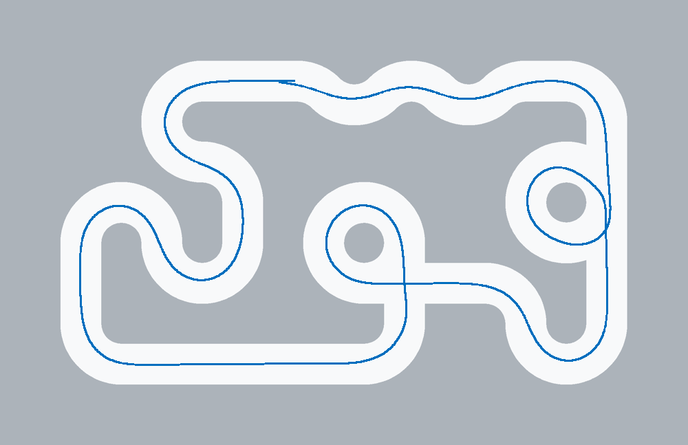
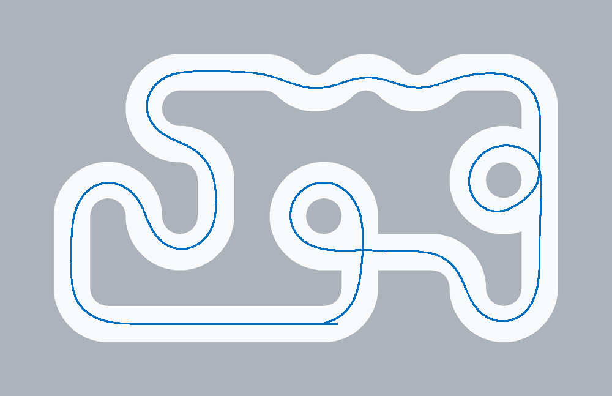

# 元素修正、弯道提速与仿真倍速验收

日期：2026-10-13。用户批准350/260/200/180mm/s、十字/环岛入口修正、倍速修复、Keil编译及双向仿真。本轮未烧录、未通电、未操作车辆。以下区分源码实现、软件/模型证据与待实车确认事项。

## 最终行为

- 普通弯道220→260、可靠外侧160→200mm/s；直道350、元素180、终点100、加速度200mm/s²、PWM300‰、PID/差速和舵机±130µs/12µs每20ms保留。Q<65仍取180限速，因此低Q外侧目标最多180。
- 十字候选保留最近180ms内的实测近场双边来向；首次斜向接近无双边时仍保留最近端单边初始化，但单边不会覆盖已有双边方向。远端出口先关联后核验当前支持，避免恢复的出口证据未参与支持检查。
- 环岛拓扑连续帧可先累积，提交候选仍须当前岛边；来向优先可靠近场双边，不让展开的远场支路定义姿态。候选期间岛边暂缺不立即清除仍可见的缺口/分支，正式入环仍须当前岛边。仅已确认候选且当前缺口、分支、岛边和有效路径成立时允许元素Q35；证据撤回即恢复普通门限并撤输出。普通道路、全黑/全白、失帧与超距保护不放宽。
- 新增左右环岛拒绝位、当前岛边与入口支持、元素超时首次阶段。autonomous_control_get_trace()保存last_good/first_bad/fault_frame、帧完成与控制时间、转向和入口摘要；故障冻结、新起跑清除。可通过调试器读取，不改屏幕与Wi-Fi。
- Tk倍速保留运行积压，分批计算与绘图降频；控制10ms和原摄像头采样不变。暂停/重置/最小化清除积压，恢复不补跑隐藏时间；工具栏显示实际倍率。
- 性能剖析定位NumPy双线性图像合成为吞吐主因。在桌面桥接增加同运算顺序double采样，默认bilinear使用C渲染，其他采样保留参考路径。相机射线、2×2采样、舍入、噪声序列和动力模型保留，没有降低图像质量或帧率。

## 工程与GUI验证

- 工程回归104项：首次98通过、6项Windows临时目录ACL错误；该6项及同组另一项在宿主复跑7/7通过。最终控制/元素相关29项复跑通过，含新增候选岛边延迟、候选缺岛边禁止通行，以及227项真实灰度联合、23041项控制器和259项集成检查。原固定600ms及固定外侧速度夹具已按加速时间和真实低Q限速更新，未降低生产保护。
- 最终仿真回归38/38通过，包含18组采样数/畸变/姿态下的逐像素比较，以及噪声、黑场和RNG序列一致性。首次沙盒5项ACL错误另有日志，宿主复跑解决。
- 真Tk检查通过：7个预设、参数保存/读回、相机拟合、大小窗口及显示；完整赛道真实事件循环通过倍率、相同时刻轨迹/像素/控制状态一致性、切速、暂停、重置、最小化恢复和回放。
- Keil全量0错误0警告，Code116728/RO13208/RW300/ZI105040字节。E:/Keil_v5/UV4/UV4.exe及同安装Armclang/fromelf；Python3.13，原生检查使用Vivado GCC6.2，仿真使用现有独立GCC。三份发布固件与构建缓存逐字节一致。
- 530个库、Wi-Fi、main、屏幕/图传和舵机等保护文件与本轮备份SHA-256一致。新增算法与GUI范围保留工作区其他既有修改。

## 双向闭环结果

使用本轮明确参数和当前主工程C源码，DLL指纹`ecb25e872a70b70d`；输入源码SHA-256已与最终文件核对。地图仅用于渲染/评分，未向控制器提供元素身份。

| 场景 | 方向 | 仿真耗时s | 最大路径偏差cm | 最大出界轮数 | 故障 |
|---|---|---:|---:|---:|---|
| 基准 | AB | 139.60 | 12.27 | 0 | 无 |
| 基准 | BA | 140.23 | 11.19 | 0 | 无 |
| 2级扰动seed7＋30mm/5° | AB | 140.47 | 12.26 | 0 | 无 |
| 2级扰动seed7＋30mm/5° | BA | 140.24 | 11.01 | 0 | 无 |

四次均完成当前参考路线，并记录十字E2及可见分叉环岛E3→E4→E5→E6。中央270°环道仍沿CURVE通过，现有前向分支证据不足，不能宣称所有环岛身份都识别正确。参考路线约30.021m，终点是仿真位置标记，不代表实车斑马线停车验收。

采样优化前后，两次基准整圈的完整telemetry.csv、末帧和轨迹PNG逐字节一致。两向实际行驶距离分别约28.939m、28.841m。

## 真实GUI倍率

每档从相同起点推进6s仿真，完整赛道原C控制器；实际倍率为仿真时间/现实时间，机器负载和视图改变会影响结果。

| 选择倍率 | 实际倍率 | 完成6s仿真的现实时间 |
|---|---:|---:|
| 0.5× | 0.500× | 12.003 s |
| 1× | 0.999× | 6.003 s |
| 2× | 1.998× | 3.002 s |
| 4× | 3.964× | 1.514 s |
| 8× | 7.442× | 0.806 s |

最初调度修正但未加速采样时，4×/8×约3.34/3.16×，未计作验收通过；优化后才完成上述检查。8×接近目标但不是保证任何负载下都精确8×。相同6s时刻的轨迹、采样帧、灰度与控制状态完全一致。GUI心跳最大间隔232.9ms（含重置/窗口操作）。

## 固件与回退

| 文件 | 字节 | SHA-256 |
|---|---:|---|
| autocar.axf | 1016348 | `05a884c4bed0fe8847ff5959582d7a5a921eee37aeecc9b3754f2e9aaa4f51b8` |
| autocar.hex | 384745 | `cd8037d75427a452b29a43d611ff91c250b1953d2226f7352b60514f571520f9` |
| autocar.bin | 136768 | `f0c9870fd51db5b44290510dfd91e21b36f9a52a7329cad52744bbeca67bb8f5` |

修改前备份：car_before-element-speed_20261013_105100.zip（已于 2026-10-15 精简中删除），753文件逐文件SHA-256与ZIP CRC通过；含工程、受影响仿真源码/预设/文档、热点与当时固件，不含仿真二进制工具链或完整Git历史。SHA-256：`27fe69a3366c862655b1e0fe2c69eb748784792b8abea655402efb2232e4dcc4`。

[验证归档](../backups/element-speed-validation_20261013_110434.zip)包含本轮输入参数、源快照/签名、四次闭环遥测/事件/轨迹、GUI结果和保护/固件核对摘要。过程日志位于logs/element-speed-*2026-10-13.log。仿真默认值和默认完整赛道预设同步，其他活动预设与“我的参数”未覆盖。

## 实车待确认

此次源码变化有软件证据，但不能据此断言A→B十字前停车、双向环岛入口和弯道偶发ELEMENT已在真实场地消失。手机拍屏无完整原始帧与同步里程，未做该实车故障的准确回放。CAMERA仅增加可读帧龄证据，未延长150ms门限，也未改冻结主循环/屏幕/Wi-Fi；缺少实时帧链路数据，尚未确定硬件现场超时原因。

实车复测按同位置双向验证，若停车，读取trace的首次拒绝/故障帧与入口拒绝位。提速后新增摆动/外推应停止该档并回退本轮受影响文件；电脑回退不等于车上固件回退，需要另行授权烧录。相机、PWM—速度、舵角/轮胎模型仍未实测标定。
