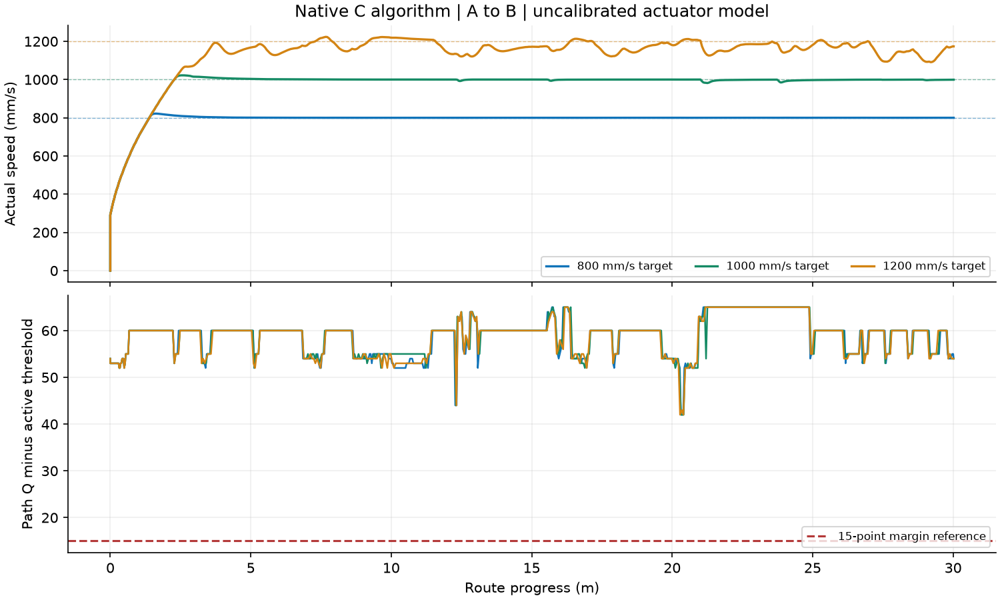

# 现场失效修正与800–1200mm/s软件验收

本轮已完成软件修改、模型条件下的分档闭环验证、工程回归和固件构建。默认四档均为800mm/s，提供1000/1200独立预设。**本轮未刷写、通电或操作车辆；现场十字和环岛是否已修复，仍需新的实车原始帧与轨迹确认。**

## 接续核对与事实

接续时最后完成的是22:18的ackpi六组，源算法与当时工作文件一致；日志却停在17:52。六组均完成，但没有逐10ms撤PWM统计、普通弯道轮迹检查或轮胎角点余量，因此作为阶段证据保留，未重复当作最终验收。后续新增检查发现的失败已留在证据包。

用户确认车轮68齿、编码器30齿、1024线；现按STEP上升沿×1采用精确1024×68/30≈2321.0667计数/轮圈。旧4352为计算错误，同一计数对应的速度和里程现为旧值1.875倍。64mm名义轮径的有效滚动周长仍待测，不能再用旧PWM/标称速度直接推断新速度。

镜头中心高度297mm、后轴前80mm、赛道内宽500mm保留。俯角、有效视场、畸变以及PWM—速度、脉宽—车轮转角未完成实车标定。120°是用户提供的镜头畸变角描述，不直接等同有效水平视场；仿真的31.46896°俯角/89.66951°水平视场仍是条件拟合。

两段外拍视频分别36.55秒、41.4秒；后者用户确认原速，设定300/200/140/160mm/s，拍到十字通过、右侧完整环岛被直行绕过。它们没有原始188×120灰度和可读拒绝位，不能当作算法逐帧回放的现场证据。

## 修改及原因

- **速度链：** 移除界面500mm/s业务上限，接受C float可表示的正有限值；PWM限额1–1000‰。自动驾驶电机后端使用自动限幅，保留遥控/台架独立限幅。超速保护和舵机软件步进均进入仿真C参数映射。速度图表根据实际/设定速度缩放。
- **质量与路径：** 保留原始边线观测Q，另计算路径可靠性。连续黑白轮廓投影到地面，使用法向半宽与当前正常宽度双边生成目标；原始宽分叉不冒充正常双边。几何控制实际采用同一毫米目标，有限性和有效距离由控制器再次检查。
- **十字：** 来向记录、出口关联与近端开口预算分开；总过程1500mm、近端持续开口700mm。避免过早预告耗尽整个路口预算；远处约760mm的交叉支路不能成为局部预瞄目标。
- **环岛：** 入口、环内、出口分别选择当前边界；近水平边界可从纵向黑白交点开始跟踪真实连接轮廓。出口分叉仍取自原图，连续确认使用最终通过检查的本帧路径，解决30Hz下原始双边评分下降导致出口确认中断的问题。保留三帧、最短里程、近端开口及阶段时距保护。
- **补线约束：** 缓存从保存时刻计龄，160mm/250ms任一超限即失效，阶段切换不续期，也不覆盖当前实测边。圆模型仅支持当前观测角度附近150mm的保守外推，线模型也限距。局部轮廓跨度至少150mm、拟合残差受限，几何目标320–780mm，常用预瞄380mm。
- **缺路拒绝：** 普通弯道和环岛都检查实际几何转向对应的前后轴横向采样点；以后轴中心弧长不超过5mm分段，图内每点须通过3×3多数白区检查，不能用其他白点抵消局部黑带。只有视野外未知区域导致失败时，允许同曲率缩至321mm并重新完整检查；可见黑块不能借此规避。未发布几何目标的像素路径另检查前向连续缺路。
- **速度控制：** 根据Ackermann几何分配左右目标，速度Ki1.0/积分限600纠正稳态误差和左右积分漂移；平均PWM与差速分别限斜率，避免转向时平均动力无意下降。几何预瞄替代曲线上的纯像素PID，像素备用控制36/0/0。
- **仿真证据：** 编码器尺度与整数舍入读取主工程头文件，元素收到编码器里程而非地图真值。新增图像延迟和模糊，30Hz调度不再量化为25Hz；保存实际送入C的帧里程和图像时刻。逐10ms统计撤PWM/速度/Q裕量，另报告四轮矩形角点道路余量。

参考了AuTop的[十字](https://github.com/SJTU-AuTop/RT1064-Code/blob/master/Project/CODE/cross.c)、[环岛](https://github.com/SJTU-AuTop/RT1064-Code/blob/master/Project/CODE/circle.c)分阶段边界处理思路，以及CMU的[Pure Pursuit原始报告](https://publications.ri.cmu.edu/implementation-of-the-pure-pursuit-path-tracking-algorithm)。本工程为独立实现，没有把其他车的尺寸和参数直接当成本车实测值。

## 当前参数

| 参数 | 默认800档 |
| --- | --- |
| 直道 / 弯道 / 可靠外侧 / 元素及低Q速度 | 800 / 800 / 800 / 800 mm/s |
| PWM上限 / 单轮超速保护 | 1000‰ / 2500 mm/s |
| 速度Kp / Ki / Kd / 前馈 | 0.5 / 1.0 / 0 / 0.8 |
| 速度积分限 / 加速度 | 600 / 200 mm/s² |
| 像素备用Kp / Ki / Kd | 36 / 0 / 0 |
| 舵机中位 / 摆幅 / 软件步进 | 1480µs / ±130µs / 40µs每20ms |
| 普通 / 可靠外侧 / 有证据元素Q门限 | 45 / 40 / 35，未降低 |
| 终点速度 / 原有故障停车 | 100mm/s / 保留 |

1000、1200预设仅把四档目标一起设为相应速度。三个新预设为simulation/configs/完整验证_800.json、完整验证_1000.json、完整验证_1200.json。默认_完整赛道_C算法与默认参数同步；“我的参数”和其余历史配置保持原字节，共11个活动入口。

## 最终结果

所有通过结果都来自真实C视觉/控制，地图只用于渲染和独立评分。正常阶段指标从起步等待与200mm/s²升速完成后统计，逐10ms计数；800档约799.8mm/s的误差为数值/闭环微小波动，不是以低速过元素。

| 目标mm/s | A→B / B→A用时s | 起步后最低实际mm/s，双向 | 最低路径Q裕量 | 最小轮胎角点余量mm |
| --- | --- | --- | --- | --- |
| 800 | 40.23 / 40.23 | 799.8 / 799.8 | 42 | 53.7 |
| 1000 | 33.34 / 33.34 | 981.6 / 982.2 | 41 | 46.9 |
| 1200 | 29.52 / 29.57 | 1090.8 / 1103.2 | 42 | 32.3 |

三档双向均完成，逐10ms撤PWM为0，旧出界判据计数0。每圈均出现两次十字确认、一次完整环岛候选→入口→环内→出口链；中央270°环形路段仍按CURVE循迹，不能声称所有环形道路身份都已识别。

附加验证：

- 350四档双向，当前控制参数下均完成，零撤PWM，最低Q裕量41。
- 旧低速参数组合350/350/350/250、PWM300、舵机步进12、Kp28/Kd0.5，仅速度Ki采用修正后的1.0：双向94.12/94.21秒完成，满足新的pass_run检查。[可复现参数](field-robustness-2026-10-13/low350-parameters.json)。
- 800/1000/1200三档双向，20ms图像延迟、0.5px高斯模糊、二级扰动seed42：全部完成、零撤PWM、Q裕量42；1200最低实际1081.6/1093.9mm/s，最小角点余量15.7mm。
- 1000双向30Hz：修正出口确认后均完成、零撤PWM、Q裕量42。失败前的冻结序列已成为正式回归。
- 1000双向40ms延迟、0.8px模糊、三级扰动seed77：完成、零撤PWM、Q裕量最低41，角点余量最低16.9mm。三级扰动含±20mm初始偏移、±4°航向、±15灰度慢变、4灰度标准差像素噪声。
- 800双向电机增益2.34375（基准1.25）完成、零撤PWM；它是敏感性试验，不是实车增益标定。

验收工具另要求正常期最低速度不低于min(800,最小设定速度)的98%，避免把低速恢复后的到达终点判为通过。共22组最终保留的闭环结果详见[汇总JSON](field-robustness-2026-10-13/run-summary.json)。final系列和低速正式组合使用最终源码；exitfix系列与最终算法、视觉配置相同，自主配置的目标/保护/舵机参数由试验覆盖，来源快照单独保留，不能冒称文件哈希完全相同。

**1200是设定值，不是全程恒速1200。** 基准增益和PWM饱和下弯中实际约1091–1103mm/s，仍在800–1200目标区间；没有为跑出结果虚增电机模型增益。更高速度、任意相机姿态、局部阴影/红砖/轮胎打滑等并未全面验收，也不能证明全局最优。

Q为工程路径指标，既不是图像像素质量也不是识别概率。原始观测Q可较低，本轮没有把它强行加到高分；更高路径Q来自新增当前轮廓和路径检验。角点余量是模型离散采样结果，不是连续碰撞证明，模型盲区也不能当作真实观测。

## 回归、构建与性能

- 工程完整130项通过；仿真完整47项通过。编码器、状态缓存、黑板/黑带/局部黑块、NaN几何目标、速度积分与硬件适配保护均有独立回归。
- GUI加载/重置、11个预设、原始Q/路径Q分开显示、1200实际运行、速度图表缩放验证通过。
- 修正旧人工夹具仅绘制到116行而导致117–119黑带的问题，保留弯道正例；真实5×5缺路反例在旧实现误放行、新实现拒绝。原EXIT固定反向像素偏置断言改为当前几何路径支持；真实外支路退出由明确拓扑冻结序列和闭环验证。
- Keil5.39/Armclang6.21全量0错误0警告，Code135968 / RO13304 / RW300 / ZI109712字节。可追踪最大静态调用栈2444字节，配置栈8192；链接报告还列出未知栈信息/函数指针/中断项，不等于板上栈峰值实测。
- Windows主机2955帧C视觉调用中位0.0415ms、P99 0.0994ms、最大0.3023ms；这是主机测量，不能换算为RT1064时限保证。

## 固件、来源与继续条件

发布文件位于outputs/firmware/autocar.axf、autocar.hex、autocar.bin，均与本轮隔离构建逐字节一致。旧tmp/build-autocar调试缓存未冒充新构建；在Keil直接下载主工程前必须重新Rebuild，或显式选择本次发布文件。本轮未启动下载器。

- AXF SHA-256：`3d3655cfd7c06f720c3f9a3aea767521777d2ed98deddaaed9b4f40151c0c27f`
- HEX SHA-256：`5fb3f303ddbbd2f8eb48eea38c1779bb702a05a221f70eab9710c926ad63dbdf`
- BIN SHA-256：`6ff0056eefdda4d56421569bf28ba84c0a5ef31de8c8d03ebf0af1669dce84a9`

[源码SHA-256](field-robustness-2026-10-13/source-sha256.json)、[525个保护文件检查](field-robustness-2026-10-13/protected-files.json)、测试日志、GUI截图及Keil调用图保存在同名证据目录。完整过程证据包 field-robustness-validation-20261013.zip（约 226 MB，已于 2026-10-15 精简中删除）；任务临时文件清理前保存选定通过/失败试验、原始合成帧、源码副本和脚本。

回退备份 autocar_before-field-robustness_20261013.zip（已于 2026-10-15 精简中删除）是任务开始前状态，**包含旧4352齿比**，不能不加辨别地拿旧计数标定进行新实车比较。需要低速确认时使用本报告已验证低速参数组合，同时保留68/30齿比修正。

剩余工作属于实车标定与验收：手转轮计数及滚动周长；真实俯角/视场与原始188×120帧；脉宽对应舵角及负载响应；PWM—轮速；板上最坏帧耗时和栈峰值。先低速核对，再逐档800、1000、1200；记录两轮速度、Q观测/路径、拒绝码与原始帧，以区分识别和机械响应。现有冻结屏幕/Wi-Fi收发逻辑未改，参考/、SeekFree/及用户视频未修改。
